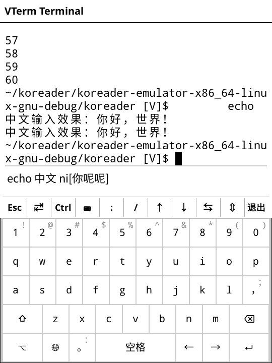
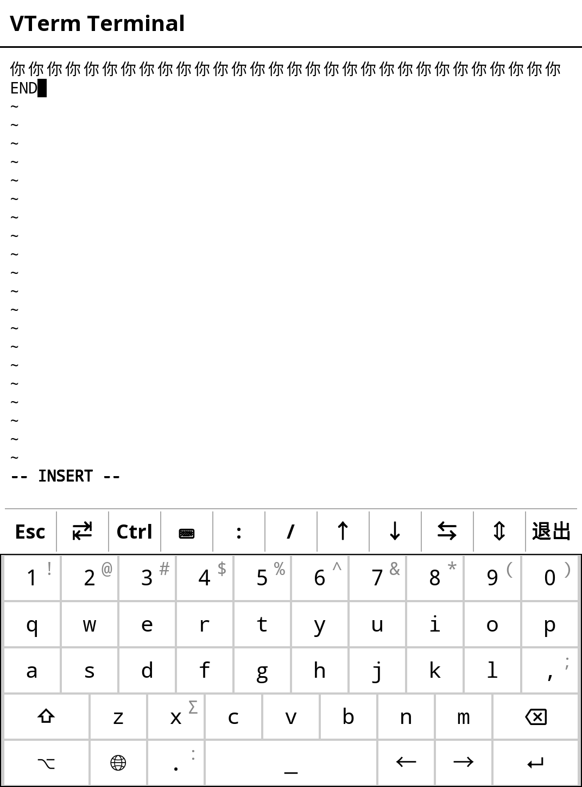

**English** | [简体中文](./README_zh.md)

# VTerm for KOReader

A full-featured terminal emulator for KOReader — a real shell on your e-reader, with Chinese input, vim, and SSH.

VTerm turns KOReader into a usable terminal: an industrial-grade VT state machine built on **libvterm** (the C core from Neovim), rendered natively in the KOReader widget system. It ships a local shell (a Unicode-enabled **busybox** `ash` plus a real statically-linked **vim 9.1** with bundled help files) and a PuTTY-style **SSH session manager** backed by Dropbear's `dbclient` — all without modifying a single file of your device's system.

Everything lives inside the plugin folder: binaries, `terminfo`, locale sources, vim runtime. Nothing is installed system-wide, nothing survives uninstall except your own session data.

## Screenshots

Local shell with the Chinese input bar (pinyin composition with inline candidates):



vim 9.1 editing a file with CJK text (fullwidth characters wrap correctly at the screen edge):



## Highlights

- **Real terminal core**: libvterm state machine driven through a LuaJIT FFI bridge — no hand-written pseudo-grid, correct cursor addressing, alternate-screen aware
- **Chinese / CJK done right**: double-width cell rendering with per-cell font binding, built-in pinyin IME with a candidate bar, history recall that deletes wide characters cleanly — zero `?` garbling in echo, `ls`, or vim
- **Real vim**: statically-linked vim 9.1 (musl), with `:help` (bundled, gzipped docs), `Ctrl+]` tag jumps and proper backspace semantics on UTF-8 text
- **PuTTY-style SSH manager**: saved sessions with host / port / user / key, connect from the KOReader menu; Dropbear key auth supported
- **E-ink tuned refresh**: partial refresh with region merging and adaptive throttling, full-screen TUIs automatically switch to a higher-quality waveform, PTY polling backs off to 1 s when idle (<1 % idle CPU)
- **Touch friendly**: quick-key bar (Esc / Tab / Ctrl / arrows / PgUp / PgDn …), full soft keyboard, swipe & pan gestures for arrows and paging, one-swipe-one-key with hold-to-repeat
- **Title bar clock & battery**: e-ink friendly (minute-aligned single wake, no polling); toggle in ⚙ Settings; tap the title bar for a full-screen refresh to clear ghosting
- **Bilingual UI**: automatic English menu when the KOReader UI language is not Chinese
- **Local scrollback**: 500–5000 lines, flick through history without touching the PTY
- **Zero system modification**: Unicode busybox, vim, `terminfo` (xterm-256color) and locale sources are all bundled; `PATH`/`TERMINFO`/`LOCPATH` are injected per-session

## Installation

- **Option 1 (recommended)**: grab the latest zip from [Releases](https://github.com/eznas/vterm.koplugin/releases), extract it, and copy the whole `vterm.koplugin/` folder into your device's KOReader plugins directory (`koreader/plugins/` on Kindle). Restart KOReader, then find **VTerm 增强终端 (PuTTY)** under *Tools → More tools*.
- **Option 2**: clone this repository into the same plugins directory:

  ```sh
  git clone https://github.com/eznas/vterm.koplugin.git
  ```

### SSH sessions

The session manager looks for Dropbear's `dbclient` binary at (in order) the plugin's `bin/`, `/mnt/us/koreader/`, and `/usr/bin/`. Kindle stock OS already ships Dropbear; otherwise drop a static `dbclient` into `bin/`. Keys must be in Dropbear format — convert OpenSSH keys with `dropbearconvert` and store them under `keys/` (referenced as `key_path` in a session).

On first launch the plugin creates a default **Local Shell** session; sessions you add are stored in `sessions.json` next to the plugin.

## Compatibility

Developed and tested on **Kindle Voyage** with recent KOReader releases (2026). The terminal itself is device-agnostic; the bundled binaries are Linux ARM (soft-float ABI) plus x86_64 for the desktop emulator. Other devices should work wherever KOReader runs, but are untested — issue reports welcome.

## Building the native core

`src/` contains libvterm and the small C bridge (`vterm_bridge.c`) that flattens libvterm's struct-by-value callbacks into scalar arguments (a LuaJIT FFI limitation). `Makefile` / `build_arm.sh` build the shared libraries for x86_64 (emulator) and armv7 softfp (Kindle).

## License

[AGPL-3.0](./LICENSE)
