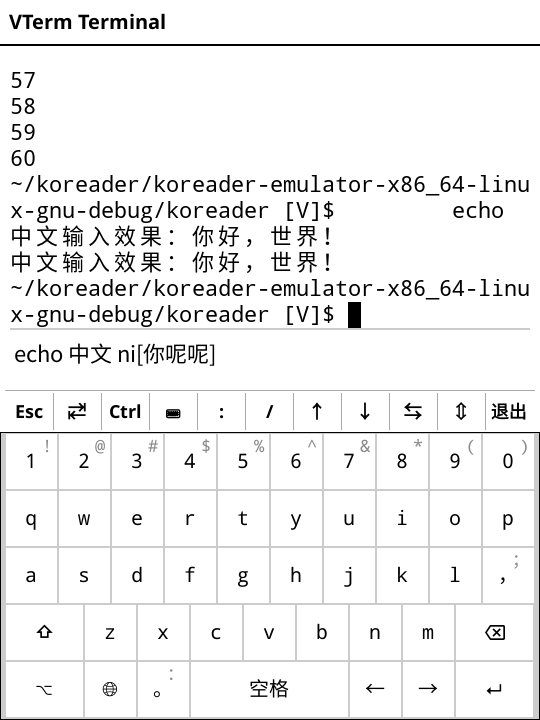
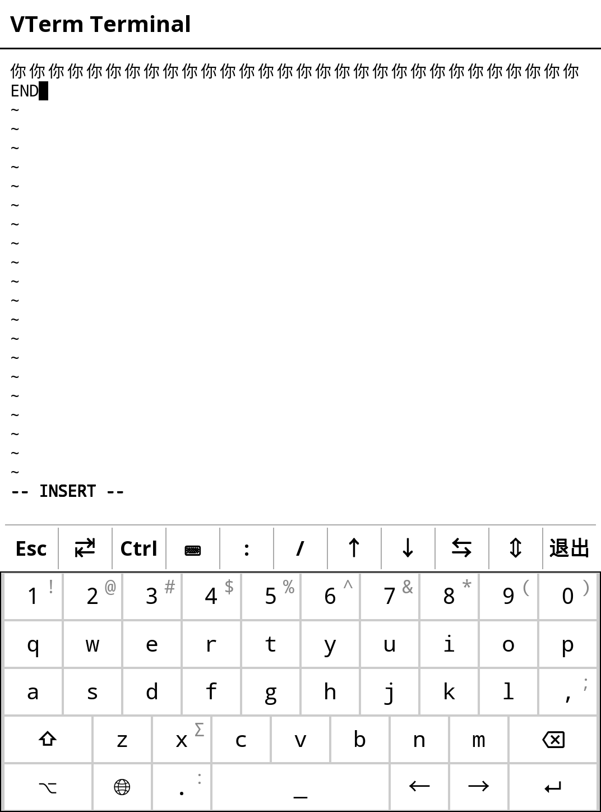

[English](./README.md) | **简体中文**

# VTerm 增强终端 (KOReader)

KOReader 的全功能终端模拟器插件 —— 在电纸书上拥有真正的 shell、中文输入、vim 与 SSH。

VTerm 让 KOReader 变成一个可用的终端：以 **libvterm**（Neovim 的 C 核心）为状态机，通过 LuaJIT FFI 桥接进 KOReader 的原生渲染体系。插件自带本地 shell（重编开启 Unicode 的 **busybox** `ash` + 静态链接的真 **vim 9.1**，帮助文件齐全）与 PuTTY 风格的 **SSH 会话管理器**（底层为 Dropbear `dbclient`）—— 不改动设备系统的任何文件。

所有东西都在插件目录内：二进制、`terminfo`、locale 源、vim 运行时。不向系统安装任何内容，卸载插件即全部移除。

## 界面截图

本地 shell 与中文输入条（拼音组词、候选条内联显示）：



vim 9.1 编辑中文文本（全角字符在行尾正确折行）：



## 特性

- **真正的终端内核**：libvterm 状态机 + LuaJIT FFI 桥（`vterm_bridge.c` 把按值传结构体的回调展平为标量传参），光标寻址、备用屏幕全部正确
- **中文彻底解决**：全角双宽格子渲染、按字形绑定中文字体；内置拼音 IME（候选条）；历史回溯按整字删除 —— 回显、`ls`、vim 里零 `?` 乱码
- **真 vim**：musl 静态链接 vim 9.1，`:h` 帮助（自带 gzip 文档）、`Ctrl+]` 跳 tag、UTF-8 退格语义正确
- **PuTTY 风格 SSH 管理**：会话可保存/编辑（主机/端口/用户/密钥），从 KOReader 菜单一键连接，支持 Dropbear 密钥认证
- **墨水屏刷新优化**：局部刷新 + 区域合并 + 自适应节流；全屏 TUI 自动升级高质量波形去残影；PTY 轮询空闲退避至 1 秒（空闲 CPU <1%）
- **触控友好**：快捷键条（`Esc / Tab / Ctrl / ⌨ / : / / / ↑ / ↓ / ⇆ / ⇕ / 退出`，开关灰底点亮）；`Ctrl` + `/` 在最近触摸格子发右键；滑动手势按 ⇆/⇕/Shift 状态映射方向键 / PgUp·PgDn / 本地历史翻页，按住连发
- **标题栏时钟与电量**：省电（分钟对齐单次唤醒，无轮询），⚙ 设置可开关；点击标题栏整屏刷新清残影
- **双语界面**：KOReader 界面语言非中文时自动切换英文菜单
- **本地回滚历史**：500–5000 行可调，翻看历史不惊动 PTY
- **零系统改动**：Unicode busybox、vim、`terminfo`（xterm-256color）、locale 源全部自带，`PATH`/`TERMINFO`/`LOCPATH` 按会话注入

## 安装

- **方式一（推荐）**：从 [Releases](https://github.com/eznas/vterm.koplugin/releases) 下载最新 zip，解压后把整个 `vterm.koplugin/` 文件夹放入设备的 KOReader 插件目录（Kindle 为 `koreader/plugins/`），重启 KOReader，在 *工具 → 更多工具* 里找到 **VTerm 增强终端 (PuTTY)**。
- **方式二**：直接把仓库克隆到同一插件目录：

  ```sh
  git clone https://github.com/eznas/vterm.koplugin.git
  ```

### Vim 帮助文档（可选）

vim 开箱即用，但 `:help` 帮助文档（约 4MB）**不打进发布 zip**（控制体积）。需要时下载 [vimruntime.zip](https://github.com/eznas/vterm.koplugin/releases/download/v1.0.0/vimruntime.zip)，解压到插件目录（得到 `vimruntime/doc/`）即可。插件升级不会删除手动安装的文档。

### SSH 会话

会话管理器按以下顺序探测 `dbclient`（Dropbear 客户端）：插件 `bin/` → `/mnt/us/koreader/` → `/usr/bin/`。Kindle 官方系统自带 Dropbear；否则把静态 `dbclient` 放进 `bin/` 即可。密钥须为 Dropbear 格式（用 `dropbearconvert` 转换 OpenSSH 私钥），存放于 `keys/` 并在会话中填 `key_path`。

首次启动会自动创建默认的**本地 Shell** 会话；之后添加的会话保存在插件目录的 `sessions.json`。

## 兼容性

在 **Kindle Voyage** + 近期 KOReader（2026）上开发并实测。终端本身与设备无关；自带二进制为 Linux ARM（软浮点 ABI）与桌面模拟器 x86_64 两套。其他设备理论上 KOReader 能跑就能用，但未实测，欢迎反馈。

## 自行编译内核层

`src/` 内含 libvterm 源码与 C 桥接层（`vterm_bridge.c`）。`Makefile` / `build_arm.sh` 分别编译 x86_64（模拟器）与 armv7 softfp（Kindle）两份动态库。

## 许可证

[AGPL-3.0](./LICENSE)
